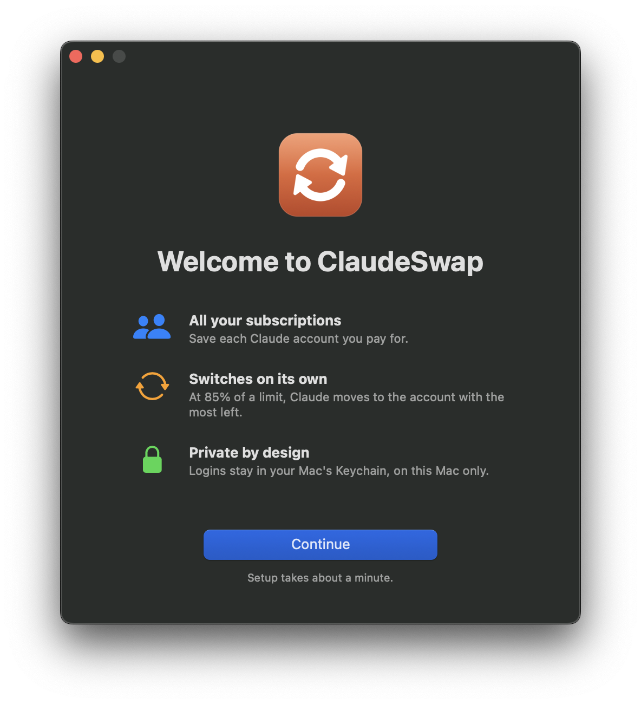
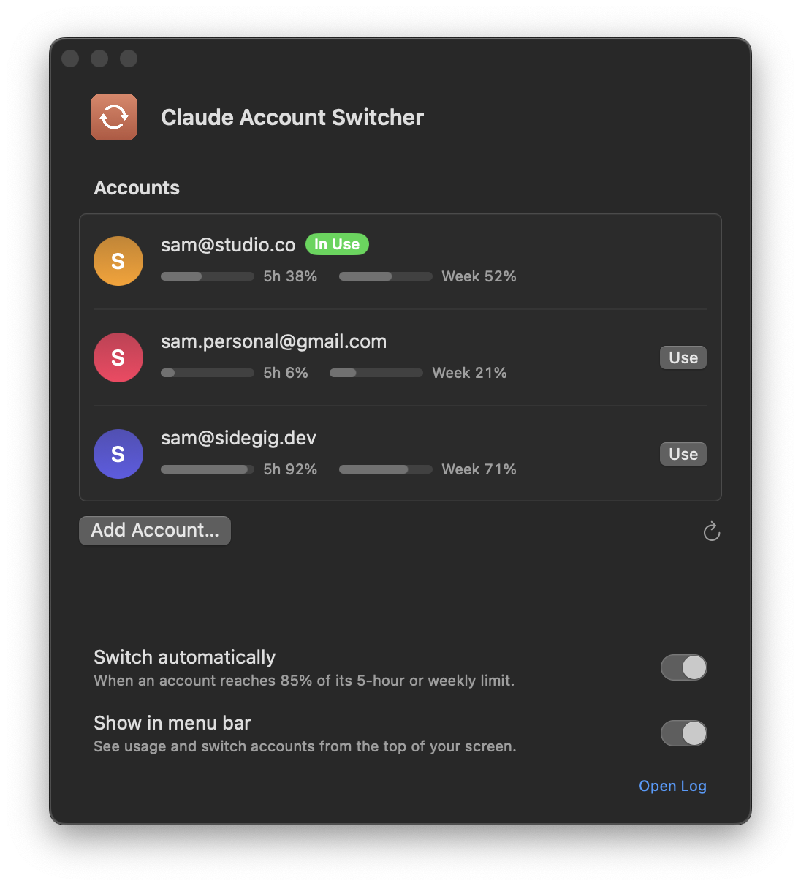

# Claude Account Switcher

<p align="center">
  
  
</p>

Got more than one Claude subscription? This Mac app keeps Claude Code and T3 Code on whichever account has the most usage left. Before one runs out, it switches to another on its own.

## Install (1 minute)

Open the **Terminal** app (press ⌘ Space and type "Terminal"), paste this line, then press Enter:

```bash
brew install --cask hmbakhsh/tap/claude-account-switcher
```

Then open **Claude Account Switcher** from your Applications folder. Click **Set up**, then **Add account** once for each Claude subscription you have.

To update: `brew upgrade --cask claude-account-switcher`

No Homebrew? Use this line instead. Run it again any time to update:

```bash
curl -fsSL https://raw.githubusercontent.com/hmbakhsh/claude-account-switcher/main/install.sh | bash
```

<details><summary>Rather not use Terminal?</summary>

Download **Claude-Account-Switcher.zip** from the [latest release](https://github.com/hmbakhsh/claude-account-switcher/releases/latest), unzip it, and drag the app into **Applications**. The first time you open it, macOS will block it. Go to **System Settings → Privacy & Security**, scroll down, and click **Open Anyway**.
</details>

## Later

- **Add an account:** open the app and click **Add Account…**.
- **Uninstall:** `brew uninstall --zap --cask claude-account-switcher`. This also stops auto-switching and removes the menu bar icon.
- **Switch now:** click the menu bar icon and pick an account.
- It keeps running after you restart your Mac.

## Good to know

- An account switches when it reaches **85%** of its 5-hour or weekly limit.
- Claude sessions that are already open move to the new account within about 30 seconds.
- Your logins stay in your Mac's Keychain. Nothing is sent anywhere.
- Only add accounts that belong to you.
- Something not working? Send the file `~/Library/Logs/claude-account-switcher.log` to whoever shared the app.

---

*For maintainers:* the app is a small SwiftUI wrapper (`app/Switcher.swift`) around [claude-swap](https://github.com/realiti4/claude-swap). To build it locally, run `app/build.sh`. To regenerate the README screenshot from sample data, run `app/screenshot.sh`. To publish a release, run `./release.sh 1.1`. It tags the release, CI builds the app and attaches it to a GitHub release, then the script bumps the cask in [hmbakhsh/homebrew-tap](https://github.com/hmbakhsh/homebrew-tap). Terminal users can run `setup.sh` instead of the app.
